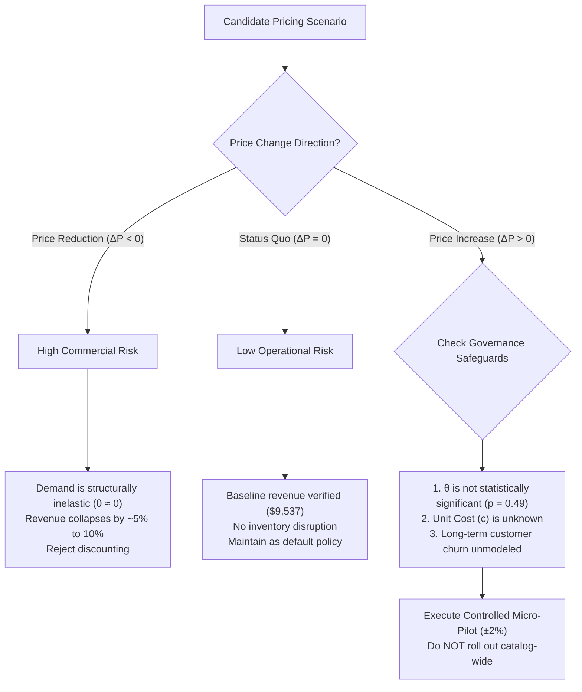

# Day 17 — Improved Pricing Decision Engine Summary

**Date:** 31 October 2026  
**Internship Role:** Data Analyst Intern at Infotact Solutions  
**Project:** EconoCausal — Causal Demand Estimation and Dynamic Pricing  

---

## 1. Executive Summary & Decision Objective

The primary objective of Day 17 is to upgrade the preliminary pricing simulator (from Days 11–13) into an **Improved Pricing Decision Engine**. Rather than treating naive revenue maximization as an automatic operational recommendation, this decision engine embeds:
1. Validated Double Machine Learning (DML) causal treatment effects and 95% confidence intervals.
2. Category-specific empirical price sensitivities established during Day 15 robustness testing.
3. Hard physical business constraints (inventory availability, stockout timing, price positivity, demand non-negativity).
4. Rigorous economic separation between **revenue optimization** and **profit optimization**, explicitly addressing the absence of product unit cost data.

---

## 2. Model Inputs and Causal Interpretation

### Double Machine Learning Treatment Effect ($\theta$)
From the validated Robinson partially linear model (Specification 1, Day 10 audit):
$$\tilde{Y}_{it} = \theta \tilde{P}_{it} + \varepsilon_{it}$$
- **Estimated Coefficient ($\theta$):** $+0.010699$ units per $\$1.00$ price increase.
- **95% Confidence Interval:** $[-0.019671, +0.041069]$.
- **Heteroskedasticity-Robust Standard Error (HC3):** $0.015495$.
- **$p$-value:** $0.4899$ (Statistically insignificant at $\alpha = 0.05$).
- **Implied Price Elasticity of Demand at Sample Mean ($\epsilon$):** $+0.0034 \approx 0.00$.

### Exact Physical Interpretation
Every $\$1.00$ increase in product price is estimated to shift daily unit demand by $+0.0107$ units. Because the 95% confidence interval cleanly spans zero, we cannot reject the null hypothesis of **perfectly inelastic demand** ($\theta = 0$). Demand neither meaningfully expands nor contracts in response to observational price adjustments within the historical pricing support ($[\$10.04, \$99.97]$).

---

## 3. Pricing Scenarios and Simulation Results

### A. Benchmark Case: Product P0001 at Store S001 (Groceries)
- **Baseline Price:** $\$55.13$
- **Baseline Daily Units Sold:** $173.00$
- **Available Inventory Cap:** $195.00$ units
- **Baseline Daily Revenue:** $\$9,537.49$

| Scenario | Candidate Price ($) | $\Delta P$ ($) | Est. Demand (Units) | 95% CI Demand Bounds | Realized Sales (Capped) | Est. Revenue ($) | Revenue $\Delta$ ($) | Revenue $\Delta$ (%) | Risk Rating & Recommendation |
| :---: | :---: | :---: | :---: | :---: | :---: | :---: | :---: | :---: | :--- |
| **$-10\%$** | $\$49.62$ | $-\$5.51$ | $172.94$ | $[172.77, 173.11]$ | $172.94$ | $\$8,581.33$ | $-\$956.16$ | $-10.03\%$ | **High Risk:** Severe revenue destruction with zero volume compensation. Reject. |
| **$-5\%$** | $\$52.37$ | $-\$2.76$ | $172.97$ | $[172.89, 173.05]$ | $172.97$ | $\$9,058.46$ | $-\$479.03$ | $-5.02\%$ | **High Risk:** Pure margin forfeiture. Reject. |
| **Baseline (0%)** | $\$55.13$ | $\$0.00$ | $173.00$ | $[173.00, 173.00]$ | $173.00$ | $\$9,537.49$ | $\$0.00$ | $0.00\%$ | **Recommended (Status Quo):** Operationally stable and verified. |
| **$+5\%$** | $\$57.89$ | $+\$2.76$ | $173.03$ | $[172.95, 173.11]$ | $173.03$ | $\$10,016.68$ | $+\$479.19$ | $+5.02\%$ | **Moderate Risk:** Favorable simulated revenue, but $\theta$ is noisy ($p=0.49$). Test in micro-pilot only. |
| **$+10\%$** | $\$60.64$ | $+\$5.51$ | $173.06$ | $[172.89, 173.23]$ | $173.06$ | $\$10,494.29$ | $+\$956.80$ | $+10.03\%$ | **Moderate-High Risk:** Do not deploy across catalog without cost data. |

### B. Category-Specific Evaluations
Using category-specific DML estimates established on Day 15:
- **Clothing ($\theta = -0.0220$, CI: $[-0.0897, +0.0457]$):** Slight negative point elasticity. A $+10\%$ price increase ($\$55.03 \rightarrow \$60.53$) reduces estimated demand from $137.28$ to $137.16$ units. Because demand drop is negligible ($-0.12$ units), simulated revenue increases by $+9.89\%$ ($+\$746.86$).
- **Electronics ($\theta = -0.0005$, CI: $[-0.0679, +0.0668]$):** Near-zero point sensitivity. A $+10\%$ price hike shifts demand by only $-0.003$ units, yielding a $+10.00\%$ revenue increase.
- **Groceries ($\theta = +0.0432$, CI: $[-0.0248, +0.1112]$):** Slight positive point estimate, but statistically insignificant ($p = 0.213$). A $+10\%$ price hike yields $+10.35\%$ simulated revenue.
- **Furniture ($\theta = -0.0158$, CI: $[-0.0847, +0.0530]$) & Toys ($\theta = +0.0021$, CI: $[-0.0651, +0.0693]$):** Consistent near-zero demand elasticity across all categories.

---

## 4. Hard Business Constraints and Operational Realities

1. **Price Positivity ($P > 0$):** All candidate prices are strictly positive ($[\$49.62, \$60.64]$).
2. **Demand Non-Negativity ($\hat{D} \ge 0$):** Enforced via truncation $\hat{D} = \max(0, D_0 + \theta \Delta P)$.
3. **Physical Inventory Bounds ($\text{Sales} \le \text{Inventory}$):**
   - In retail, realized sales cannot exceed available shelf/warehouse inventory: $\text{Sales} = \min(\hat{D}, I)$.
   - For Benchmark Product P0001, baseline inventory is $195.0$ units, while peak estimated demand is $173.23$ units. Thus, the inventory constraint is **non-binding** under normal operating volume.
4. **Inventory Measurement Timing Caveat:**
   - Operational inventory must be recorded at start-of-day before store opening ($I_{t}^{\text{start}}$).
   - If a dataset records inventory at end-of-day ($I_{t}^{\text{end}} = I_{t}^{\text{start}} - \text{Sales}_t$), capping demand by $I_{t}^{\text{end}}$ introduces severe post-treatment truncation. Store managers must verify ERP stock snapshot timestamps before enforcing automated stockout caps.

---

## 5. Economic Trade-Off: Revenue vs. Profit & The Missing Cost Problem

### The Theoretical Disconnect
A pervasive fallacy in algorithmic pricing is equating **revenue maximization** with **business value creation**. 

The firm's commercial objective is **Gross Operating Profit** ($\Pi$), defined as:
$$\Pi(P) = (P - c) \cdot \text{Sales}(P) - F$$
where:
- $P$ is retail selling price per unit.
- $c$ is marginal wholesale procurement cost (Cost of Goods Sold / COGS).
- $F$ is store fixed overhead.
- $(P - c)$ is the unit contribution margin ($m$).

The first-order conditions illustrate why revenue and profit diverge:
$$\frac{d\text{Revenue}}{dP} = \text{Sales}(P) + P \frac{d\text{Sales}}{dP}$$
$$\frac{d\Pi}{dP} = \text{Sales}(P) + (P - c) \frac{d\text{Sales}}{dP} = \frac{d\text{Revenue}}{dP} - c \frac{d\text{Sales}}{dP}$$

Because marginal cost $c > 0$, whenever demand responds to price ($\frac{d\text{Sales}}{dP} < 0$), profit is maximized at a **higher price and lower volume** than revenue.

### Crucial Project Limitation: Missing Unit Cost Data
> [!IMPORTANT]
> **Definitive Finding on Cost Information:**
> An exhaustive audit of `retail_inventory_cleaned.csv` and the upstream database confirms that **Unit Cost / COGS is absent from the dataset**. The dataset tracks only selling `Price`, `Units Sold`, `Inventory Level`, and `Revenue`.
> 
> **Therefore, formal mathematical profit optimization cannot yet be performed.** Claiming to determine an "optimal price" without procurement cost accounting data is analytically invalid. Recommending aggressive discounting or expansion solely to maximize top-line revenue could inadvertently erode margins and generate operating losses.

---

## 6. Managerial Decision Framework

Rather than declaring an unvalidated "optimal price", the Improved Pricing Decision Engine establishes a three-tier decision matrix:

### Strategic Recommendations:
1. **Never Discount Under Inelastic Demand:** With near-zero elasticity, price cuts of $-5\%$ or $-10\%$ produce an immediate $-5.02\%$ to $-10.03\%$ revenue decline without stimulating volume.
2. **Treat $+10\%$ Simulated Revenue as an Upper-Bound Ceiling:** Simulated revenue gains of $+10.03\%$ ($+\$956.80$) rely on the assumption that customer demand is completely indifferent to higher prices. Because the true parameter could be negative ($\text{CI low} = -0.0197$), uncritical price hikes could trigger unobserved substitution.
3. **Deploy Micro-Pilots Prior to Catalog Rollout:** Implement phased $\pm 2\%$ price testing on select stores before any broad price restructuring.
