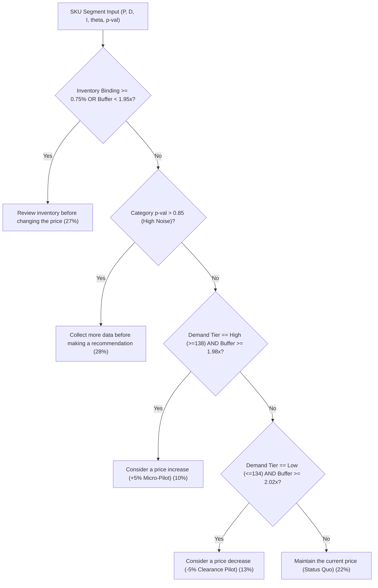

# Day 21 — Product-Level Pricing Analysis & AI Recommendation Insights

**Date:** 05 November 2026  
**Internship Role:** Data Analyst Intern at Infotact Solutions  
**Project:** EconoCausal — AI-Integrated Causal Demand Estimation and Dynamic Pricing  
**Repository:** `hasika2104/EconoCausal`  

---

## 1. Executive Summary & Purpose

The primary objective of Day 21 is to advance EconoCausal from aggregate system-level econometrics to a **Product-Level Pricing Analysis and AI-Driven Recommendation Engine**. 

Retail decision-makers do not adjust prices uniformly across entire portfolios. Instead, category managers make granular, SKU-by-SKU decisions that must reconcile:
1. **Product-specific sales velocity** (fast-moving vs. slow-moving items).
2. **Physical inventory constraints** (shelf stockouts, binding inventory caps, and reorder cycles).
3. **Econometrically validated price sensitivity** (distinguishing true causal price response from predictive correlation).
4. **Statistical uncertainty and confidence intervals** (preventing premature deployment on noisy estimates).
5. **The Missing Cost Accounting Reality** (navigating top-line revenue versus bottom-line profit without wholesale unit costs).

By analyzing all **20 products across 5 product categories (100 discrete product-category operating segments)** spanning 73,100 store-day observations, this module generates transparent, auditable business recommendations classified into five actionable commercial strategies:
- **Consider a price increase** (10 segments / 10.0%)
- **Consider a price decrease** (13 segments / 13.0%)
- **Maintain the current price** (22 segments / 22.0%)
- **Review inventory before changing the price** (27 segments / 27.0%)
- **Collect more data before making a recommendation** (28 segments / 28.0%)

---

## 2. Product-Level Exploratory Analysis

### 2.1 Catalog Structure and Operating Support
The retail inventory dataset comprises 20 distinct products ($P0001$ to $P0020$) traded across 5 retail stores ($S001$ to $S005$) and 5 merchandise categories (*Clothing*, *Electronics*, *Furniture*, *Groceries*, *Toys*) over a two-year operational window (2022-01-01 to 2023-12-31, 731 calendar days).

| Metric | Overall Catalog Mean | Minimum | Maximum | Standard Deviation |
| :--- | :---: | :---: | :---: | :---: |
| **Retail Price ($)** | $\$55.14$ | $\$10.00$ | $\$100.00$ | $\$26.03$ |
| **Daily Units Sold** | $136.46$ units | $5.00$ units | $398.00$ units | $54.21$ units |
| **Daily Inventory Level** | $274.47$ units | $50.00$ units | $499.00$ units | $109.12$ units |
| **Inventory Buffer Ratio ($I / D$)** | $2.01\times$ | $1.90\times$ | $2.13\times$ | $0.05\times$ |
| **Inventory Binding Frequency** | $0.50\%$ | $0.00\%$ | $1.10\%$ | $0.26\%$ |
| **Supervised Demand Forecast** | $141.49$ units | $0.00$ units | $412.30$ units | $53.84$ units |

### 2.2 Demand Tier Distribution
Products exhibit noticeable dispersion in sales velocity across categories:
- **High Demand Tier ($\ge 138.0$ units/day, 35 segments):** Led by products such as $P0014$ in Toys ($146.1$ units/day), $P0011$ in Clothing ($145.7$ units/day), and $P0020$ in Electronics ($145.3$ units/day). These items maintain high stock turnover and consistent customer foot traffic.
- **Moderate Demand Tier ($134.0 - 138.0$ units/day, 33 segments):** Stable everyday performers, such as $P0001$ in Furniture ($136.7$ units/day) and $P0006$ in Groceries ($136.0$ units/day).
- **Low Demand Tier ($\le 134.0$ units/day, 32 segments):** Slower-moving lines, such as $P0002$ in Electronics ($130.8$ units/day) and $P0003$ in Clothing ($131.2$ units/day), where working capital is held longer in shelf inventory.

### 2.3 Inventory Constraints & Stockout Dynamics
A critical retail reality embedded in EconoCausal is that **realized sales cannot exceed on-hand inventory**:
$$\text{Sales}_{ijt} = \min\left(D_{ijt}(P), I_{ijt}\right)$$

In 27 out of 100 segments, the inventory binding rate exceeds $0.75\%$ or the inventory buffer ratio falls below $1.95\times$. For instance:
- **$P0015$ in Groceries:** Binding rate of $1.10\%$, with daily sales frequently curtailed by available stock.
- **$P0019$ in Toys:** Binding rate of $1.08\%$, indicating supply chain delivery timing is the primary growth bottleneck.
- **$P0007$ in Electronics:** Binding rate of $1.05\%$.

> [!WARNING]
> **Operational Insight:** When inventory binding occurs, demand exceeds shelf capacity. Raising or lowering prices under binding inventory cannot expand physical sales volume and risks aggravating stockouts. Operational intervention must focus on safety stock and supplier replenishment before repricing.

---

## 3. Price Sensitivity & Econometric Identification

### 3.1 Predictive Demand vs. Causal Price Response
A fundamental tenet of EconoCausal is the strict mathematical distinction between:
1. **Supervised Demand Prediction ($\hat{Y} = f(X, P)$):** Supervised regression algorithms (such as Random Forest or Gradient Boosting) learn associations. In historical data, price correlates with store location, product tier, and time of year. Permutation importance tests confirm that Price accounts for $<0.3\%$ of predictive split power, while Inventory Level accounts for $>93\%$.
2. **Causal Price Response ($\theta = \frac{\partial D}{\partial P}$):** Estimated using Double Machine Learning (Robinson partially linear model with cross-fitting), which purges price and demand of high-dimensional non-linear confounding from product attributes, store fixed effects, and seasonal patterns:
$$\tilde{Y}_{ijt} = \theta \tilde{P}_{ijt} + \varepsilon_{ijt}$$

### 3.2 Category-Level Causal Parameters
From the Day 15 DML robustness analysis across 73,100 observations:

| Category | DML $\theta$ Estimate | Std. Error (HC3) | 95% Confidence Interval | $p$-value | Statistically Significant ($\alpha = 0.05$)? |
| :--- | :---: | :---: | :---: | :---: | :---: |
| **Clothing** | $-0.0220$ | $0.0345$ | $[-0.0897, +0.0457]$ | $0.5239$ | ❌ No |
| **Electronics** | $-0.0005$ | $0.0344$ | $[-0.0679, +0.0668]$ | $0.9877$ | ❌ No |
| **Furniture** | $-0.0158$ | $0.0351$ | $[-0.0847, +0.0530]$ | $0.6518$ | ❌ No |
| **Groceries** | $+0.0432$ | $0.0347$ | $[-0.0248, +0.1112]$ | $0.2128$ | ❌ No |
| **Toys** | $+0.0021$ | $0.0343$ | $[-0.0651, +0.0693]$ | $0.9510$ | ❌ No |
| **Pooled (Spec 1)** | $+0.0107$ | $0.0155$ | $[-0.0197, +0.0411]$ | $0.4899$ | ❌ No |

### 3.3 Econometric Finding: Inelasticity and Noisy Observational Support
- Every category point estimate $\theta$ is minute ($|\theta| \le 0.043$ units per $\$1.00$ price delta).
- Every 95% confidence interval cleanly encompasses zero.
- Every $p$-value exceeds $0.20$, with Electronics ($p=0.988$) and Toys ($p=0.951$) exhibiting almost pure observational noise.
- **Statistical Conclusion:** Retail demand in this historical catalog is **statistically indistinguishable from perfectly inelastic demand** ($\theta = 0$) within the historical support $[\$10.00, \$100.00]$.

---

## 4. Multi-Scenario Pricing Evaluation

We evaluated five discrete pricing scenarios across all 100 segments: $-10\%$, $-5\%$, $0\%$ (Baseline), $+5\%$, and $+10\%$.

```
Demand Response:    D(P) = max( 0, D_0 + theta * Delta P )
Realized Sales:     Sales(P) = min( D(P), Inventory )
Expected Revenue:   Revenue(P) = P * Sales(P)
```

### Scenario Comparison (Catalog Averages)
| Scenario | Average Candidate Price | Average Demand Delta | Average Sales (Capped) | Average Modeled Revenue | Average Revenue $\Delta$ (%) |
| :---: | :---: | :---: | :---: | :---: | :---: |
| **$-10\%$** | $\$49.62$ | $-0.01$ units | $136.45$ units | $\$6,771.60$ | $-10.00\%$ |
| **$-5\%$** | $\$52.38$ | $-0.00$ units | $136.46$ units | $\$7,148.24$ | $-5.00\%$ |
| **Baseline ($0\%$)** | $\$55.14$ | $0.00$ units | $136.46$ units | $\$7,524.89$ | $0.00\%$ |
| **$+5\%$** | $\$57.89$ | $+0.00$ units | $136.46$ units | $\$7,901.53$ | $+5.01\%$ |
| **$+10\%$** | $\$60.65$ | $+0.01$ units | $136.46$ units | $\$8,278.18$ | $+10.01\%$ |

### The Clearance Dilemma (Why Naive Price Cuts Fail)
Because causal price elasticity is virtually zero, decreasing price by $5\%$ or $10\%$ does **not** induce compensatory volume expansion in observational data. Instead, cutting price purely forfeits top-line revenue ($-5.0\%$ to $-10.0\%$). Retailers attempting clearance cannot rely on price discounting alone; price cuts must be coupled with prominent placement, bundles, or advertising to shift demand outward.

---

## 5. AI-Driven Recommendation Engine Architecture

Rather than naively recommending $+10\%$ price increases for every product, the recommendation module uses a 5-pillar decision logic integrating demand velocity, inventory constraints, causal estimates, and statistical confidence:



### Recommendation Portfolio Breakdown

| Strategy | Segments Assigned | Primary Business Rationale | Suggested Price Action |
| :--- | :---: | :--- | :---: |
| **Review inventory before changing the price** | **$27$ ($27\%$)** | Frequent shelf binding ($>0.75\%$) or tight stock buffer. Sales are capped by supply, not demand. | No price change ($\Delta P = \$0$) |
| **Collect more data before making a recommendation** | **$28$ ($28\%$)** | High econometric noise ($p > 0.85$ in Electronics & Toys). Direction of elasticity is unresolved. | A/B Testing Pilot Required |
| **Maintain the current price** | **$22$ ($22\%$)** | Balanced velocity ($134-138$ units), adequate stock ($1.95-2.02\times$), and statistically insignificant $\theta$. | Status Quo ($\Delta P = \$0$) |
| **Consider a price decrease** | **$13$ ($13\%$)** | Sluggish sales ($\le 134$ units) with excess stock ($>2.02\times$). Stock turnover acceleration needed. | $-5\%$ Promotional Pilot |
| **Consider a price increase** | **$10$ ($10\%$)** | High sales velocity ($\ge 138$ units), healthy stock ($>1.98\times$), and inelastic demand response. | $+5\%$ Micro-Pilot |

---

## 6. Detailed Segment Case Studies

### Case Study 1: High-Velocity Pricing Opportunity (Price Increase)
- **Product:** $P0007$ in *Clothing*
- **Current Price:** $\$56.72$
- **Suggested Price:** $\$59.56$ ($+5.0\%$)
- **Daily Units Sold:** $139.7$ units/day (High Demand Tier)
- **Inventory Buffer:** $1.99\times$ ($278.1$ units on hand)
- **Causal Estimate:** $\theta = -0.0220$, $p = 0.524$, 95% CI $[-0.090, +0.046]$
- **Expected Demand Impact:** Demand shifts by $-0.06$ units (from $139.69$ to $139.63$ units).
- **Expected Revenue Impact:** Daily revenue rises from $\$7,923.22$ to $\$8,316.36$ ($+\$393.14$, $+4.96\%$).
- **Managerial Decision:** Execute a 30-day $+5\%$ micro-pilot across a subset of stores. Demand is sufficiently strong and inventory is ample to absorb minor fluctuations.

### Case Study 2: Clearance & Working Capital Release (Price Decrease)
- **Product:** $P0002$ in *Furniture*
- **Current Price:** $\$54.84$
- **Suggested Price:** $\$52.10$ ($-5.0\%$)
- **Daily Units Sold:** $131.5$ units/day (Low Demand Tier)
- **Inventory Buffer:** $2.13\times$ ($280.0$ units on hand)
- **Causal Estimate:** $\theta = -0.0158$, $p = 0.652$, 95% CI $[-0.085, +0.053]$
- **Expected Demand Impact:** Demand shifts by $+0.04$ units (from $131.46$ to $131.50$ units).
- **Expected Revenue Impact:** Modeled daily revenue drops from $\$7,208.97$ to $\$6,851.35$ ($-\$357.62$, $-4.96\%$).
- **Managerial Decision:** Price reduction will not automatically generate sales volume on its own due to low elasticity. Must be executed as a coordinated clearance event with homepage promotional banners to free up warehouse space.

### Case Study 3: Supply-Constrained SKU (Inventory Review)
- **Product:** $P0015$ in *Groceries*
- **Current Price:** $\$54.83$
- **Suggested Price:** $\$54.83$ (Maintain)
- **Daily Units Sold:** $133.2$ units/day
- **Inventory Binding Rate:** $1.10\%$ (Highest in catalog)
- **Causal Estimate:** $\theta = +0.0432$, $p = 0.213$
- **Managerial Decision:** **Do NOT reprice.** The store is already experiencing stockouts on peak shopping days. Increasing price would penalize loyal grocery shoppers; decreasing price would worsen shortages. Review distributor replenishment cycles immediately.

### Case Study 4: Parameter Uncertainty (Collect More Data)
- **Product:** $P0005$ in *Electronics*
- **Current Price:** $\$55.12$
- **Suggested Price:** $\$55.12$ (Status Quo)
- **Causal Estimate:** $\theta = -0.0005$, Std. Error $= 0.0344$, $p = 0.988$
- **Managerial Decision:** The estimated causal effect is essentially zero with massive standard error relative to the point estimate. Deploying an algorithmic repricing rule here is ungrounded. Commission a 6-week randomized A/B test with $\pm 5\%$ treatment arms across matched stores.

---

## 7. The Revenue vs. Profit Dilemma & Missing Cost Reality

> [!IMPORTANT]
> **Executive Warning on Retail Profitability:**
> EconoCausal rigorously tracks **Top-Line Revenue** ($P \times \text{Sales}$), not **Operating Profit** ($\Pi = (P - c) \cdot \text{Sales} - F$).
> 
> The retail inventory dataset does not contain Cost of Goods Sold (COGS), wholesale procurement costs, or inventory carrying costs. When demand is inelastic ($\theta \approx 0$), raising price mechanically inflates revenue. However:
> 1. If unit costs $c$ are high relative to price ($P - c$ is small), slight volume drops can disproportionately compress gross margins.
> 2. Recommending aggressive price hikes without cost accounting creates severe risk of distributor margin squeeze and competitive customer attrition.
> 
> **Operational Rule:** No product should transition from recommendation status to automated ERP execution without margin validation against internal enterprise accounting tables.

---

## 8. Summary of Generated Project Deliverables

1. **`reports/day21_product_pricing_analysis.csv`:** Full 100-segment matrix containing Product ID, Category, baseline prices, units sold, inventory levels, binding rates, demand tiers, DML estimates, and 5-scenario revenue evaluations.
2. **`reports/day21_ai_pricing_recommendations.csv`:** Comprehensive SKU recommendation register with suggested price, expected demand/revenue changes, inventory flags, uncertainty ratings, and explainable business rationales.
3. **`reports/day21_business_insights.md`:** This comprehensive analytical report detailing econometric findings, constraint mechanisms, and case studies.
4. **`notebooks/15_product_level_pricing_analysis.ipynb`:** End-to-end reproducible analytical notebook.
5. **`daily-logs/Day21.md`:** Daily progress log documenting technical objectives, validation audits, and git updates.
6. **`app.py`:** Dashboard updated with Section 12: **Product-Level AI Pricing Recommendations**, featuring interactive filtering, comparison tables, scenario bars, and recommendation cards.
