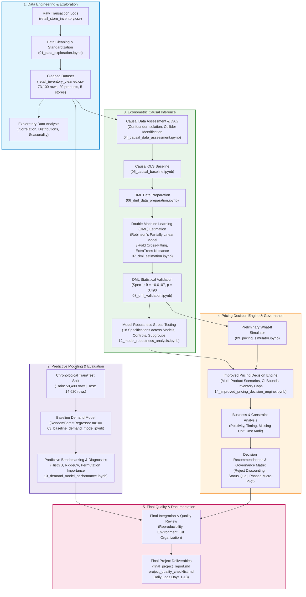

# EconoCausal — End-to-End Project Workflow

**Author:** Data Analyst Intern at Infotact Solutions  
**Project:** EconoCausal — Causal Demand Estimation and Dynamic Pricing  
**Date:** 01 November 2026  

---

## 1. Executive Workflow Diagram

The flowchart below visualizes the complete analytical, econometric, and decision-engineering pipeline implemented across the 18 development days of the EconoCausal project:

---

## 2. Stage-by-Stage Implementation Summary

### Stage 1: Data Cleaning & Preprocessing (Days 1–4)
- **Input:** Raw retail store inventory records.
- **Actions:** Deduplication, missing value verification, date casting, temporal feature engineering (`Year`, `Month`, `DayOfWeek`).
- **Output:** Cleaned analysis dataset `data/processed/retail_inventory_cleaned.csv` ($N = 73,100$).

### Stage 2: Baseline Predictive Modeling (Days 5 & 16)
- **Input:** Cleaned transaction table.
- **Actions:** Evaluated supervised regression models (`RandomForest`, `HistGradientBoosting`, `RidgeCV`) on an $80/20$ chronological holdout test set ($N_{\text{test}} = 14,620$).
- **Findings:** Random Forest achieves holdout $R^2 = 0.3184$ (MAE $69.51$ units). Decomposed feature importance: `Inventory Level` drives predictive power (test permutation drop in $R^2 = +0.7118$), while `Price` is minimal ($+0.0029$). Identified severe regression to the mean in prediction residuals.

### Stage 3: Causal Identification & Double Machine Learning (Days 6–10, 15)
- **Input:** Preprocessed feature matrices.
- **Actions:** Formulated DAG; isolated confounding fixed effects; applied Robinson's partially linear model with $3$-fold cross-fitting and HC3 standard errors.
- **Findings:** Baseline treatment effect $\theta = +0.0107$ ($p = 0.490$, 95% CI: $[-0.0197, +0.0411]$). Verified robustness across 18 specifications (models, controls, categories, regions, years, price trimming); $0$ out of $18$ specifications are statistically significant at $\alpha = 0.05$. Demand is structurally price-inelastic.

### Stage 4: Pricing Decision Engine & Business Constraints (Days 11–13, 17)
- **Input:** Validated DML parameters and inventory levels.
- **Actions:** Evaluated candidate pricing scenarios ($\pm 5\%, \pm 10\%$), applied hard inventory caps ($\text{Sales} = \min(\hat{D}, I)$), audited the dataset for unit cost data, and derived the profit vs. revenue divergence.
- **Findings:** Inelastic demand renders discounting destructive ($-10\%$ price cuts reduce revenue by $-10.03\%$). Confirmed that unit procurement cost ($c$) is missing from the data, establishing that formal profit optimization cannot yet be performed. Recommended maintaining status-quo pricing while initiating controlled micro-pilots ($\pm 2\%$).

### Stage 5: Final Review, Quality Assurance & Documentation (Days 14 & 18)
- **Actions:** Audited repository reproducibility, verified relative paths across all 13 notebooks, validated virtual environment packages, confirmed `.gitignore` hygiene, and published comprehensive project documentation.
